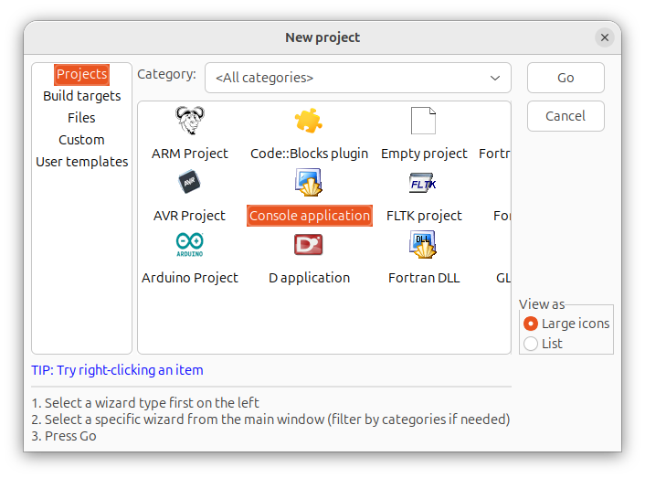

# Среда разработки Code::Blocks: проекты и настройки

Code::Blocks — бесплатная среда разработки (IDE), рассчитанная на небольшие, в том числе учебные проекты. 
Есть версия IDE включающая компилятор языка С (mingw), не требующий установки дополнительных программ и плагинов. Интерфейс CodeBlocks не перегружен второстепенными возможностями.


## 1. Установка
https://www.codeblocks.org/downloads/binaries/

Рекомендуется скачивать нужно, в названии которой есть `mingw`, например `codeblocks-25.03mingw-setup.exe`. Такая сборка уже содержит компилятор; версия без `mingw` — только сама среда, и компилятор пришлось бы устанавливать отдельно.

После установки стоит проверить, что среда видит компилятор: `Settings → Compiler…` → вкладка `Toolchain executables` → кнопка `Auto-detect`. Если автоопределение не сработало, путь к папке с компилятором указывают вручную в поле `Compiler's installation directory`.

<!-- Рис. 1. Окно Settings → Compiler, вкладка Toolchain executables -->

Настройки среды по умолчанию хранятся в профиле пользователя (`%APPDATA%\codeblocks` в Windows), поэтому саму программу можно установить и в обычную папку, в том числе на флешку.


## 2. Создание проекта

В Code::Blocks исходный код программы оформляется как проект. Проект хранит список файлов с кодом и настройки сборки исполняемого файла вашей программы или библиотеки (версию языка, перечень сторонних библиотек и т.п.). Отдельный файл с кодом (например main.cpp) неудобен: среда разработки не будет знать, как его собирать.

Порядок создания консольного проекта:

1. `File → New → Project…`.
2. В списке шаблонов выбрать `Console application` и нажать `Go`.
3. Выбрать язык **C** (не C++).
4. Задать название проекта (`Project title`), папку (`Folder to create project in`) и имя файла проекта. Путь лучше делать без кириллицы и пробелов — это избавляет от части проблем с компилятором и отладчиком.
5. Оставить компилятор выбранный по умолчанию и обе конфигурации сборки — `Debug` и `Release`.
6. Нажать `Finish`.



Среда создаст проект с файлом `main.c` с программой «Hello, World!» и откроет его в редакторе.

<!-- Рис. 2. Мастер создания проекта: выбор языка C -->
<!-- Рис. 3. Мастер создания проекта: имя и папка проекта -->

Сборка и запуск:

| Действие | Клавиши |
|---|---|
| Собрать | `Ctrl+F9` |
| Запустить | `Ctrl+F10` |
| Собрать и запустить | `F9` |
| Пересобрать | `Ctrl+F11` |
| Очистить результаты сборки | `Build → Clean` |

Текущая цель сборки (`Debug` или `Release`) выбирается в панели инструментов. При запуске через `F9` среда сама задерживает консольное окно; если запускать готовый `.exe` напрямую, окно может закрыться сразу — тогда в конец `main` добавляют `getchar();` или запускают программу из консоли.


## 3. Из чего состоит проект

Проект — это папка с исходными и служебными файлами. Пусть проект называется `hello`. Тогда типичный набор будет таким:

| Файл / папка | Назначение | Можно удалять |
|---|---|---|
| `hello.cbp` | файл проекта: список файлов, цели сборки, настройки компилятора и линкера | нет |
| `hello.layout` | расположение панелей и окон среды | да |
| `hello.depend` | служебные зависимости между файлами | да |
| `main.c` | исходный код | нет |
| `my_unit.h` | заголовочный файл (если программа разбита на модули) | нет |
| `bin/Debug/hello.exe` | исполняемый файл | да |
| `obj/Debug/main.o` | объектный файл | да |

Чтобы снова открыть проект, открывают главный файл проекта -- `hello.cbp`. Это обычный текстовый файл в формате XML: его можно открыть в редакторе и увидеть, например, список файлов проекта и ключи компилятора.

В панели `Management` проект показан деревом: вкладка `Projects` содержит виртуальные папки (например, `Sources` и `Headers`), а вкладка `Symbols` — функции и переменные проекта. Виртуальные папки не обязаны совпадать с папками на диске.

<!-- Рис. 4. Дерево проекта в панели Management -->

## 4. Что можно безопасно удалять

- `bin/` и `obj/` — можно: при следующей сборке они создаются заново.
- `*.layout`, `*.depend`, `*.o`, `*.exe` — можно.
- `*.cbp`, `*.c`, `*.h` — нельзя: это исходные данные проекта.

Удаление `.cbp` не уничтожает код, но теряет настройки и список файлов: проект придётся создавать заново и добавлять в него файлы. Поэтому перед удалением папки проекта стоит убедиться, что исходники сохранены отдельно.

Штатные способы очистки: `Build → Clean` удаляет результаты сборки, `Project → Remove files…` убирает файл из проекта, не удаляя его с диска.

Для системы контроля версий в `.gitignore` достаточно добавить:

```
bin/
obj/
*.layout
*.depend
*.exe
*.o
```

## 6. Настройка версии стандарта языка C

В актуальных сборках Code::Blocks (GCC 14) по умолчанию используется диалект `gnu17` — это C17 с расширениями GNU. Чтобы зафиксировать стандарт и отключить расширения, в настройках проекта указывают ключ `-std`:

1. `Project → Build options…`.
2. Выбрать проект или конкретную цель (`Debug`/`Release`) в левом дереве.
3. Вкладка `Compiler settings` → подвкладка `Other compiler options` (в некоторых версиях — `Other options`).
4. Добавить `-std=c17` (или `-std=c23`, если компилятор поддерживает C23).

<!-- Рис. 5. Окно Build options: ключ -std=c17 -->

Проверить выбранный стандарт можно макросом `__STDC_VERSION__`:

```c
#include <stdio.h>

int main(void) {
    printf("%ld\n", __STDC_VERSION__);
    return 0;
}
```

Для C17 макрос равен `201710L`, для C11 — `201112L`, для C23 — `202311L`. Подробнее о стандартах и ключах компилятора — в разделе [Компиляция программы](100_compile.md).

Настройки можно задать и глобально, для всех новых проектов: `Settings → Compiler…`. Но для учебных проектов удобнее хранить их в самом проекте, чтобы они не зависели от настроек компьютера.


## 7. Подключение математической библиотеки

Функции из `math.h` (`sqrt`, `sin`, `pow` и др.) находятся в отдельной библиотеке `libm`. Директива `#include <math.h>` только подключает объявления, но не саму библиотеку, поэтому при компоновке нужно указать `-lm`.

Через интерфейс:

1. `Project → Build options…`.
2. Вкладка `Linker settings`.
3. В списке `Link libraries` нажать `Add` и ввести `m`.
4. Подтвердить и пересобрать проект.

<!-- Рис. 6. Окно Build options: добавление библиотеки m -->

Тот же результат даёт запись `-lm` в поле `Other linker options`. Проверить подключение можно программой:

```c
#include <stdio.h>
#include <math.h>

int main(void) {
    double x = 2.0;
    printf("%f\n", sqrt(x));
    return 0;
}
```

Если библиотека не подключена, компоновка завершится ошибкой `undefined reference to 'sqrt'`. В MinGW под Windows библиотека часто подключается неявно, но `-lm` не мешает и делает проект переносимым на Linux.


## 8. Другие важные настройки

**Предупреждения.** Ключи `-Wall -Wextra` включают предупреждения о подозрительном коде. Их добавляют в `Other compiler options` рядом с `-std`. Полезно привыкнуть читать предупреждения, а не игнорировать их.

**Отладочная информация.** Цель `Debug` по умолчанию собирается с ключом `-g`, поэтому отладчик может сопоставлять машинный код с исходным. Для цели `Release` отладочную информацию обычно отключают и включают оптимизацию.

**Кодировка.** В `Settings → Editor… → General settings` выбирают кодировку UTF-8. Если русский текст в консоли отображается неправильно, дополнительно настраивают локаль и кодировку консоли — см. [Локаль и кодировка символов](120_locale_encoding.md).

**Рабочая директория.** Программы, которые читают или пишут файлы, ищут их относительно рабочей директории. Её задают в `Project → Properties… → Build targets → Execution working directory`. Если этого не сделать, файл может создаваться не рядом с исходником, а в папке проекта или в другом месте.

**Аргументы командной строки.** `Project → Set program's arguments…` позволяет передать программе аргументы так, как если бы она запускалась из консоли.

**Несколько файлов.** Файлы добавляют в проект через `Project → Add files…`, заголовочные подключают директивой `#include "…"`. Сборка нескольких модулей описана в разделе [Модульное программирование](700_modules.md).

**Отладчик.** Точка останова ставится щелчком слева от номера строки. Запуск отладки — `Debug → Start/Continue`, пошаговое выполнение — `Debug → Next line`, `Step into`, `Step out`. Значения переменных видны в окне `Watches`. Горячие клавиши отладки можно посмотреть и изменить в `Settings → Editor → Keyboard shortcuts`. Общие принципы отладки — в разделе [Компиляция, запуск и отладка в Zed](110_compile_run_debug_in_zed.md).


## 9. Типичные проблемы

| Симптом | Причина | Решение |
|---|---|---|
| `It seems that this file has not been built yet` | проект не собран | `Ctrl+F9`, затем `Ctrl+F10` |
| `undefined reference to 'sqrt'` | не подключена библиотека `m` | добавить `m` в `Linker settings` |
| Неправильное отображение русских букв | несовпадение кодировок | UTF-8 в редакторе, настройка локали, см. [120_locale_encoding.md](120_locale_encoding.md) |
| `Permission denied` | программа ещё запущена | закрыть окно программы |
| Проект не собирается после переноса | абсолютные пути в `.cbp` | пересоздать проект или поправить пути |
| Компилятор не найден | не указан путь к GCC | `Settings → Compiler → Toolchain executables → Auto-detect` |


## Смотрите также

- [Компиляция программы](100_compile.md)
- [Компиляция, запуск и отладка в Zed](110_compile_run_debug_in_zed.md)
- [Локаль и кодировка символов](120_locale_encoding.md)
- [Модульное программирование](700_modules.md)
- Официальная документация: <https://wiki.codeblocks.org/>
